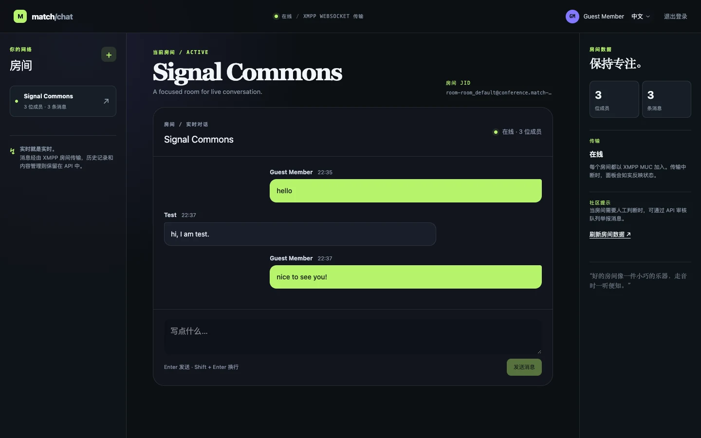
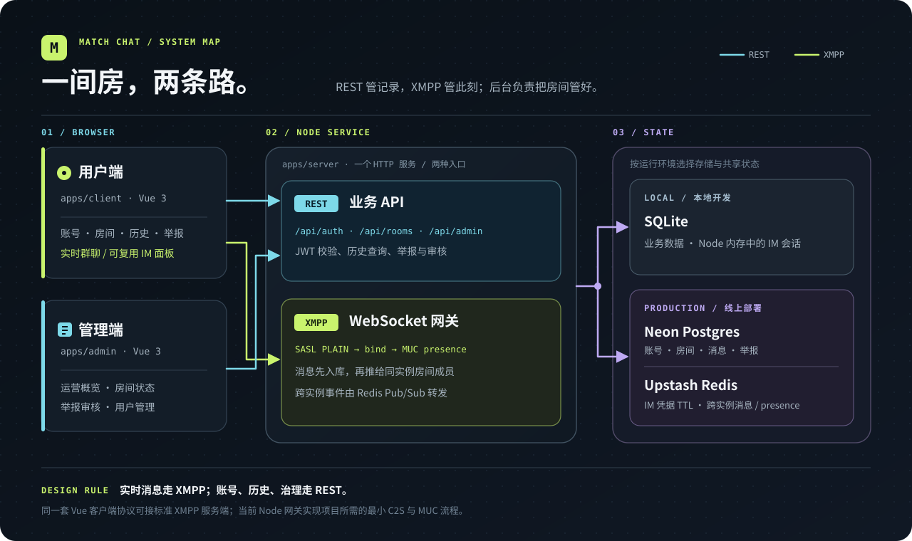
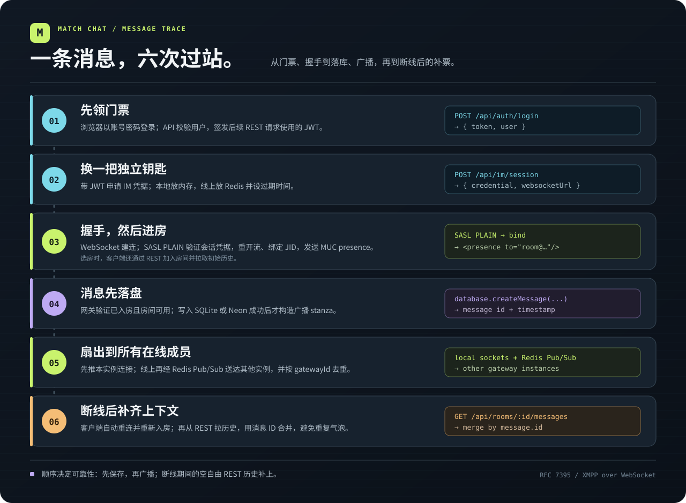

# Match Chat 技术拆解：REST 管业务，XMPP 跑实时群聊

> 聊天需求通常写得很短：“消息要实时。”真正动手时，这五个字会长出鉴权、入群、跨实例广播、断线补偿和内容审核。消息发出前是一行文字，发出后就像一个需要户口、车票和行程记录的旅客。

Match Chat 是一个可运行的群聊平台：Vue 用户端负责聊天，Vue 管理端负责房间和举报，Node 服务同时提供 REST API 与 XMPP over WebSocket 网关，`packages/im-ui` 则把聊天面板和 XMPP 客户端封装成可复用组件。它最有意思的选择，是让 **REST 管持久业务，XMPP 管实时会话**。两条路各司其职，断线时再汇合。

**项目预览：**[用户端](https://wkylin.github.io/chat-platform/client/) · [管理端](https://wkylin.github.io/chat-platform/admin/) · [服务健康检查](https://match-chat-server-seven.vercel.app/api/health)。用户端可用公开演示账号 `guest` / `guest123!`；管理端密码由部署环境的 `IM_ADMIN_PASSWORD` 配置。



*图 1：用户端实拍。登录后可选择房间、读取历史消息，并通过 XMPP WebSocket 收发新消息。*

## 一张图看清边界



用户端与管理端都是静态前端，GitHub Pages 只负责送出页面。账号、房间、历史、举报和审核请求进入 REST API；消息与入群 presence 则走 XMPP WebSocket。服务在本地使用 Node 内置 SQLite；配置 `DATABASE_URL` 后换成 Neon PostgreSQL。生产环境再用 Upstash Redis 保存 XMPP 会话并在多个网关实例之间转发房间事件。入口选择写在 [`server.ts`](../../apps/server/src/server.ts)，所以前端组件不必知道数据库今天住在哪座楼。

这里有一条刻意保留的协议边界：浏览器使用标准 `@xmpp/client`，Node 网关实现本项目需要的 RFC 7395 WebSocket framing、SASL PLAIN、资源绑定和 MUC 群聊流程。它是**最小 XMPP 网关**，不是通用 XMPP 服务器。想把它当完整 Prosody 用，协议扩展大概会先举手抗议。

## 从登录到入群：先换票，再上车

浏览器先用 `/api/auth/login` 取得 REST JWT，再调用 `/api/im/session` 换一张独立的 XMPP 会话票。会话凭证由 24 字节随机数编码而成，默认有效期与 API JWT 一样是七天；生产环境的会话记录存进 Redis，并可按用户批量撤销。这样，WebSocket 的 SASL 认证使用的是会话凭证，而不是把 REST JWT 直接塞进聊天协议里。

代码预览，摘自 [`xmpp.ts`](../../apps/server/src/xmpp.ts)：

```ts
const session: SessionRecord = {
  id: `im_${randomUUID().replaceAll("-", "").slice(0, 18)}`,
  userId: user.id,
  username: user.username,
  credential: randomBytes(24).toString("base64url"),
  expiresAt: Date.now() + this.lifetimeSeconds * 1000,
};
```

接下来，`@xmpp/client` 通过 WebSocket 发 `<open/>`，网关给出 SASL PLAIN 机制；认证成功后重新开流、绑定资源，客户端才发送 MUC presence 加入房间。网关用 `await-open → await-auth → await-restart → await-bind → bound` 这组状态管理握手。每条连接还有一条 Promise 队列，让收到的 stanza 顺序进入处理函数，避免异步查库把“先入群、后发言”处理成反过来：

```ts
for (const stanza of result.stanzas) {
  connection.queue = connection.queue
    .then(() => this.handleStanza(connection, stanza))
    .catch((cause) => console.error("[xmpp] stanza handling failed", cause));
}
```

这段节选来自 [`XmppGateway.receive()`](../../apps/server/src/xmpp.ts)。队列保证**同一连接的处理顺序**；它不声称为不同用户、不同网关建立全局顺序。

## 一条消息的行程：数据库盖章，Redis 喊话



消息到达网关时，服务先确认连接已绑定、发言者已入房、内容非空且未超过长度上限，再确认房间仍开放。随后写入数据库，拿到服务端生成的消息 ID、时间戳和发送者资料，向本机房间连接广播，最后通过 Redis Pub/Sub 把事件送到其他实例。关键路径在 [`handleMessage()`](../../apps/server/src/xmpp.ts)：

```ts
if (connection.phase !== "bound" || !connection.user) return;
if (!roomId || !body || body.length > this.config.maxMessageLength) return;
const room = await this.database.getRoom(roomId);
if (!room || room.status !== "active") return;
const message = await this.database.createMessage(roomId, connection.user.id, body);
const from = `${room.jid}/${connection.nickname}`;
const payload = `<message from="${escapeXml(from)}" type="groupchat" id="${escapeXml(message.id)}"><body>${escapeXml(message.body)}</body><x xmlns="${META_NAMESPACE}" userId="${escapeXml(message.userId)}" displayName="${escapeXml(message.displayName)}" createdAt="${escapeXml(message.createdAt)}"/></message>`;
for (const member of this.roomConnections.get(roomId) || []) this.send(member, payload);
await this.publishEvent(roomId, "message", payload);
```

“先落库，后广播”让实时回显和历史记录共用同一个服务端 ID。用户端发送时也不抢先把草稿插进列表，而是等服务端回显；否则客户端自造一条、服务端再回一条，聊天窗口会像复读机。Redis 事件带 `gatewayId`，订阅者跳过自己发出的事件，避免本机广播再来一遍。这个小字段不显眼，但省掉了“我为什么收到了两个我”的排查夜晚。

## 一套数据库接口，两种时间观念

本地 SQLite 使用 Node 的 `DatabaseSync`，Neon PostgreSQL 则通过异步请求访问。同一条 REST 路由和同一个 XMPP 网关怎么接住两者？[`ChatDatabase`](../../apps/server/src/db.ts) 把返回值写成 `Awaitable<T>`，调用处统一 `await`：普通值会立即得到结果，Promise 则等待完成。相关签名摘录如下：

```ts
export type Awaitable<T> = T | Promise<T>;

export interface ChatDatabase {
  listMessages(roomId: string, limit?: number): Awaitable<MessageRecord[]>;
  createMessage(roomId: string, userId: string, body: string): Awaitable<MessageRecord>;
}
```

这样，选择 SQLite 或 Neon 的代码集中在服务启动处，消息处理流程不必长出两套分支。代价也清楚：本地 SQLite 的同步读写会占用 Node 事件循环；这个接口统一的是**调用方式**，不是两种存储的吞吐和延迟。网关先持久化再广播的选择，也让数据库写入时间直接进入发送延迟预算。

## 断线补账：实时通道不负责记账本

Redis Pub/Sub 负责在线扩散，不保存离线消息。`@xmpp/client` 重连并再次进入 `online` 时，会重新发 presence 入房；用户端同时通过 REST 拉取最近的房间历史，把结果与当前消息按服务端 ID 去重并按时间排序：

```ts
const result = await request<{ messages: ImChatMessage[] }>(`/rooms/${roomId}/messages`);
if (selectedRoom.value?.id !== roomId) return;
const unique = new Map<string, ImChatMessage>();
for (const message of [...result.messages, ...messages.value]) unique.set(message.id, message);
messages.value = [...unique.values()].sort((a, b) => a.createdAt.localeCompare(b.createdAt));
```

代码位于 [`App.vue`](../../apps/client/src/App.vue)。这里的设计很实用：XMPP 负责低延迟送达，数据库负责可重新读取的事实。但“补账”也有边界：REST 默认只取最近 80 条，长时间离线或高流量房间还需要分页游标；Pub/Sub 发布失败时，其他实例的在线用户可能要等下一次历史同步才能看到那条消息。

## 管理端：聊天之外还有秩序


*图 2：线上管理端登录入口。管理员密码由部署环境配置，不随静态页面发布。*

举报入口要求用户已加入房间，且被举报消息确实属于该房间。管理端走 REST 审核举报、暂停房间、停用账号，以及把消息状态从 `visible` 改为 `removed`。聊天面板读到 `removed` 会显示占位文案，而非直接删除历史行；审核因此留有记录，也不会让对话时间线凭空塌一块。

这套审核仍有一个明确边界：现有实现没有把“消息已移除”实时广播到所有在线聊天窗口；打开中的视图要重新进入房间或重新加载，才会读到新状态。重连补账时，合并逻辑还会让内存中的旧消息覆盖同 ID 的历史记录，因此单靠重连也不能刷新这条审核状态。管理端的 `activeUsers` 指**状态为 active 的账号数**；房间的 `memberCount` 来自入房成员表。两者都不是当前 WebSocket 在线人数。如果直接拿去做运营大屏，数字会很有信心，含义却可能悄悄跑偏。

## 本地跑起来，再决定下一步

项目是 pnpm workspace，四个包分别是用户端、管理端、服务端和可复用 IM UI。使用 Node.js 22.5+ 后，在不同终端运行：

```bash
pnpm install
pnpm dev:server
pnpm dev:client
pnpm dev:admin
```

本地用户端是 `http://localhost:5178`，管理端是 `http://localhost:5179`，API 位于 `http://localhost:8787`，XMPP WebSocket 是 `ws://localhost:8787/xmpp-websocket`。本地演示用户同样可用 `guest` / `guest123!`；本地管理员初始密码见项目 [`README`](../../README.md)，生产环境由 `IM_ADMIN_PASSWORD` 设置。

Match Chat 已经把一条消息最容易被忽略的旅程串起来：认证、入群、持久化、跨实例扩散、断线补齐、举报审核。若继续向生产级平台推进，下一步值得补的是消息幂等键、可分页的历史补偿、审核事件实时同步，以及对网关 XML 解析和 WebSocket 部署环境做更完整的协议与负载验证。聊天框可以很轻，消息的行李箱还是得认真打包。
